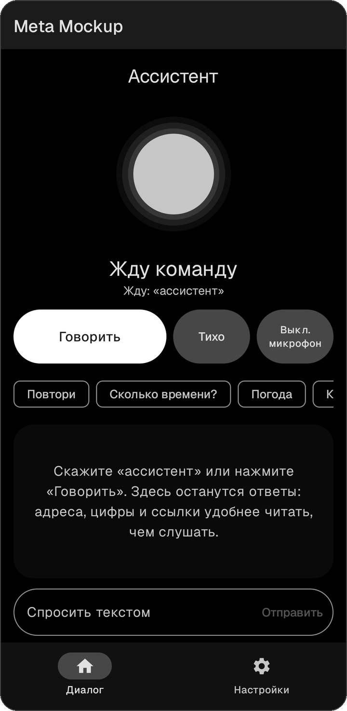
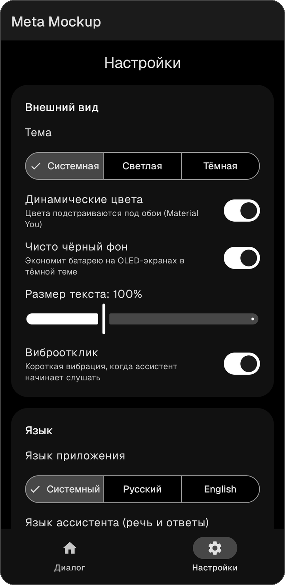
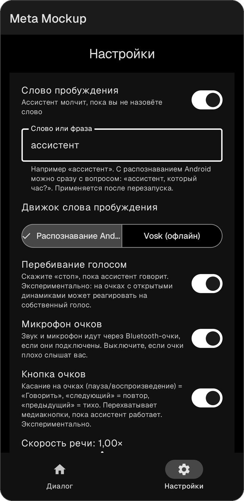

# Meta Mockup


A voice assistant for smart glasses (Ray-Ban Meta or any Bluetooth glasses and headphones), in **Russian and English**.
It runs in the background, listens through the glasses' microphone, answers out loud, and doesn't make up facts: time, weather, exchange rates, reference answers and web results come from real sources, and the assistant names them.

> A personal, experimental project. It has not been tested on real glasses yet.

## Screenshots

<p>



</p>

## Features

- **Background operation.** A foreground service with a persistent notification; the "Talk", "Microphone" and "Stop" buttons are right in it.
- **Several ways to start talking.** Wake word, the **Talk** button, a **Quick Settings tile**, a **home screen widget**, the **"Talk" app shortcut** (long-press the icon), and optionally the **button on the glasses' frame** (media buttons).
- **Wake word, two engines.** Android speech recognition (also accepts "assistant, what time is it?" in one phrase) or **Vosk offline** (downloadable model, much lower battery use).
- **Interrupt by voice.** Say "stop" while the assistant is speaking (experimental).
- **Short answers made for listening.** The point comes first, numbers and units are spelled out, no markdown. Ask "more detail" for a longer answer.
- **Verifiable facts.** The model calls tools and states the source and the time of the data:
  - date and time, from the phone;
  - weather: [Open-Meteo](https://open-meteo.com);
  - exchange rates: Bank of Russia ([cbr-xml-daily.ru](https://www.cbr-xml-daily.ru));
  - reference answers: Wikipedia (in the assistant's language);
  - **web search**: DuckDuckGo (no key) or Tavily (API key).
- **Translation.** Ask "translate … to English" and the answer is spoken with a voice of the target language.
- **Voice commands handled locally, without calling the model.** "Stop" / "quiet", "repeat", "slower", "faster", "more detail".
- **Any OpenAI-compatible API.** DeepSeek, OpenRouter, Kimi, Yandex AI Studio and others: all you need is a URL, a key and a model. The model list loads with one button, with search and a `:free` filter.
- **Two languages everywhere.** The app UI and the assistant (speech recognition, voice, answers, commands, prompts) each switch between **Russian and English** in Settings.
- **Material 3 with your own look.** Light / dark / system theme, Material You dynamic colors or six accent colors, pure black background for OLED, text size slider, haptic feedback, an animated state indicator, conversation history, quick commands, text input and TalkBack support.
- **Clear errors.** "No connection", "Check your key", "Model is overloaded" instead of silence.

## How it works

```
glasses mic ─► wake word (Vosk / Android) ─► SpeechRecognizer ─► LlmClient ──► tools
                                                                     │          (time, weather, rates,
glasses speakers ◄─────────────── TextToSpeech ◄─────────────────────┘           Wikipedia, web search)
```

| File | Purpose |
|---|---|
| `AssistantService.kt` | Background service: Bluetooth audio routing, the listen → think → speak loop, wake word, barge-in, media button, local commands, UI state |
| `LlmClient.kt` | `/chat/completions` client with history and a function-calling loop, plus friendly error mapping |
| `Tools.kt` | Tools and caching: time, Open-Meteo, Bank of Russia rates, Wikipedia, web search |
| `VoskModels.kt` | Download and storage of the offline wake word models |
| `Lang.kt` | Language data: recognizer/voice locales and the local voice commands per language |
| `UiPrefs.kt` | Appearance settings and the Material 3 theme (dynamic or custom accent colors) |
| `AssistantScreen.kt`, `SettingsScreen.kt`, `MainActivity.kt` | Dialog screen, settings, navigation |
| `TriggerActivity.kt`, `AssistantTile.kt`, `AssistantWidget.kt` | Tile, widget and shortcut entry points |

## Requirements

- Android 12 or newer (`minSdk 31`)
- Bluetooth glasses or headphones (optional: the phone's microphone is used without them)
- An API key from any OpenAI-compatible provider
- To build: Android SDK 35, JDK 17–21, Gradle 8.9+

## Download

Debug builds are attached to the [Releases](../../releases) page. They are signed with a debug key, so Android will ask you to allow installing from unknown sources.

## Build and install

```bash
git clone https://github.com/grskst2012-cell/meta-mockup.git
cd meta-mockup
```

1. Open the folder in Android Studio, wait for Gradle sync, then **Run** on your phone.
2. Or build from the command line (`local.properties` must contain `sdk.dir=...` pointing to your Android SDK):

   ```bash
   gradle :app:assembleDebug
   ```

   The APK ends up in `app/build/outputs/apk/debug/app-debug.apk`.

> JDK 25 does not work with Kotlin 2.0.21; use JDK 17–21. If the project path contains non-Latin characters, add `-Pandroid.overridePathCheck=true`.

## Setup

1. Pair the glasses with your phone over Bluetooth like regular headphones.
2. Open **Settings** → **Language** and choose the app and assistant languages.
3. In **Model and key** enter the URL, key and model. "Show models" opens a list; your choice is saved immediately.
4. For weather, enter your city in **Live data**. Optionally pick a web search provider.
5. Tap **Remove battery restrictions** so the system does not put the assistant to sleep.
6. On the **Dialog** tab tap **Start assistant** and grant the microphone and notification permissions.
7. Optional: add the **Assistant** tile to Quick Settings or the widget to your home screen. For the offline wake word choose **Vosk (offline)** in **Voice** and download the model (about 40–45 MB).

Example providers:

| Provider | Base URL | Model |
|---|---|---|
| DeepSeek | `https://api.deepseek.com` | `deepseek-chat` |
| OpenRouter | `https://openrouter.ai/api/v1` | any, including `:free` ones |
| Kimi (Moonshot) | `https://api.moonshot.ai/v1` | from the Moonshot console |

Fact checking through tools works only if the model supports function calling. If it does not, the assistant answers without sources.

## Usage

- Say the wake word: "**assistant**, what's the weather?", or just "assistant" and give the command after the beep.
- Or tap **Talk** in the app, in the notification, on the tile or the widget.
- After an answer you can keep talking without the wake word; after a pause the assistant goes back to waiting for it.
- "Stop", "repeat", "slower", "more detail" take effect instantly, with no model request.
- "Translate to English: where is the station?": the translation is spoken in English.

## Limitations

- The wake word based on Android recognition drains the battery noticeably, may beep on restart on some firmware, and may use the network. **Vosk** is lighter, but it only catches the word (the command that follows is recognized by Android) and the word must exist in the model's vocabulary.
- A microphone service cannot be started from the background (an Android 14+ rule), so it is started from the open app, the tile, the widget or the shortcut.
- Interrupting by voice and the glasses-button support are experimental: open-ear speakers can feed the assistant's own voice back into the microphone, and whether the glasses send media-button events to the phone is not verified.
- Whether Vosk and Android recognition can use the glasses' Bluetooth microphone depends on the glasses and codec; the behavior of Ray-Ban Meta as a headset has not been verified.
- DuckDuckGo search is scraped and may break or be blocked in some regions; Tavily is more reliable.
- Free models and providers can be unstable (HTTP 429), and availability depends on your region.

## Roadmap

- [ ] Stream the model's answer into speech sentence by sentence
- [ ] Glasses camera via the Meta Wearables Device Access Toolkit

## Privacy

Your API keys and settings are stored only on the phone. Requests are sent to the model provider you choose (and, if enabled, to the web search and data sources listed above); for weather only the city name is sent, never coordinates. Conversation history lives in the app's memory and can be cleared in settings. While the assistant is running, Android shows the microphone indicator.

## Research

The app's requirements are based on research into what smart-glasses owners need on the go (written in Russian):
[`reports/Ассистент для умных очков UX.md`](reports/%D0%90%D1%81%D1%81%D0%B8%D1%81%D1%82%D0%B5%D0%BD%D1%82%20%D0%B4%D0%BB%D1%8F%20%D1%83%D0%BC%D0%BD%D1%8B%D1%85%20%D0%BE%D1%87%D0%BA%D0%BE%D0%B2%20UX.md)
(source notes are in `research_notes/`).

## License

[MIT](LICENSE)
